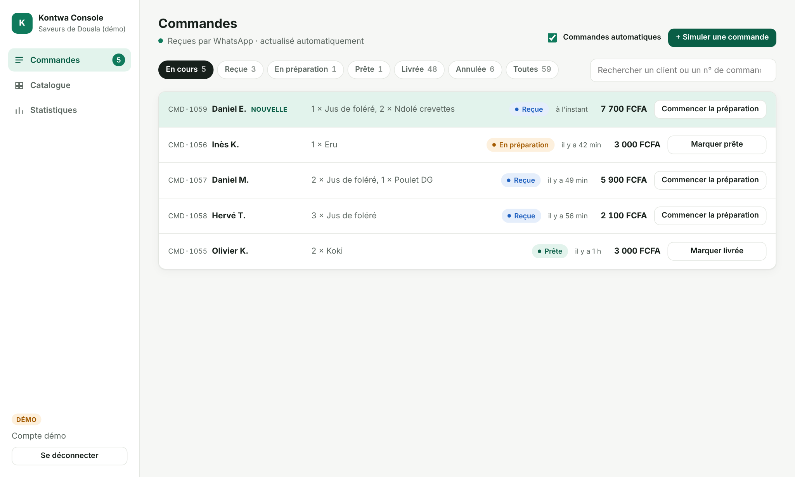
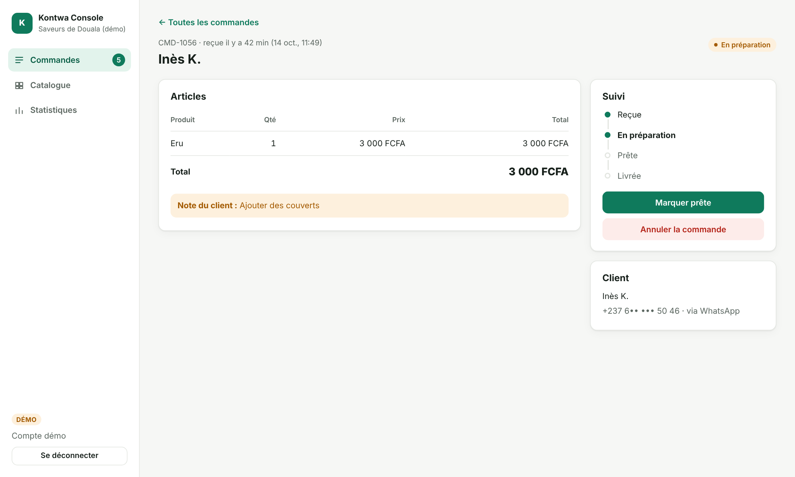
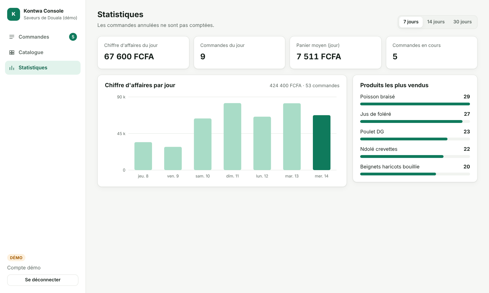

# Kontwa Console

[](https://github.com/Kameni2000/kontwa-console/actions/workflows/ci.yml)

**Tableau de bord commerçant pour Kontwa**, l'assistant qui prend les commandes des petits commerces sur WhatsApp.
Le commerçant voit arriver ses commandes en temps réel, les fait avancer (reçue → en préparation → prête → livrée), gère son catalogue et suit ses ventes.

**Démo en ligne : [kontwa-console.vercel.app](https://kontwa-console.vercel.app)** — compte démo : `demo@kontwa.app` / `demo1234`
*(données fictives ; la démo tourne entièrement dans le navigateur)*



## Fonctionnalités

| | |
|---|---|
| **Commandes en temps réel** | Rafraîchissement automatique, mise en évidence des nouvelles commandes, filtres par statut avec compteurs, recherche par client ou numéro. |
| **Suivi d'une commande** | Détail des articles, note du client, frise de suivi, actions limitées aux transitions autorisées. |
| **Catalogue** | Création et modification avec formulaires réactifs validés, disponibilité en un clic, suppression avec confirmation. |
| **Statistiques** | Chiffre d'affaires et commandes du jour, panier moyen, graphique sur 7, 14 ou 30 jours (SVG fait main), produits les plus vendus. |
| **Responsive** | Barre latérale sur ordinateur, navigation en bas de l'écran sur téléphone, thème sombre automatique. |

<p>
  
  
</p>

## Architecture

```
kontwa-console/
├── web/   Angular 18 — l'application du commerçant
└── api/   ASP.NET Core 8 (C#) — l'API REST
```

**Front-end — Angular 18**
- Composants *standalone*, nouvelle syntaxe de contrôle (`@if`, `@for`), `ChangeDetectionStrategy.OnPush` partout.
- **Signals** pour l'état (`signal`, `computed`) et **RxJS** pour les flux (rafraîchissement avec `timer` + `exhaustMap`, `switchMap`, `toSignal`).
- Routes chargées à la demande (*lazy loading*), **garde de route** pour les pages protégées, paramètres de route liés aux `input()` des composants.
- **Intercepteurs HTTP** : ajout du jeton et déconnexion automatique sur 401 ; faux back-end pour la démo statique.
- **Formulaires réactifs** typés avec validation.
- Aucune bibliothèque d'interface : CSS maison avec des variables de thème (clair et sombre), graphique en SVG accessible.

**Back-end — ASP.NET Core 8 (Minimal API)**
- Endpoints REST : commandes, changement de statut, catalogue (CRUD), statistiques.
- **Authentification par jeton** signé HMAC-SHA256 avec un `AuthenticationHandler` personnalisé ; mot de passe vérifié par `PasswordHasher` (jamais stocké en clair).
- **Limitation des tentatives de connexion** (10 par minute et par IP), CORS restreint, erreurs métier renvoyées en JSON avec le bon code HTTP (400, 404, 409).
- Les mêmes **règles métier** que le front (cycle de vie des commandes, calcul des statistiques), testées des deux côtés.

**Qualité**
- 29 tests unitaires Angular (Jasmine/Karma), 8 tests de bout en bout Playwright (ordinateur et mobile), 32 tests xUnit côté API.
- Intégration continue GitHub Actions : tests, build et tests de bout en bout à chaque push.

## Lancer le projet

**Front seul (mode démo, aucun serveur nécessaire)**
```bash
cd web
npm install
npm start            # http://localhost:4200
```

**Front + API réelle**
```bash
cd api/Kontwa.Api
dotnet run           # http://localhost:5080/api

cd web
npm run start:api    # le front appelle l'API au lieu du faux back-end
```

**Tests**
```bash
cd web && npm run test:ci && npm run e2e
cd api && dotnet test
```

## Sécurité et données

- Toutes les données sont **fictives** ; les numéros de téléphone sont masqués.
- En production, la clé de signature des jetons se configure par variable d'environnement (`Auth__SigningKey`) et ne figure pas dans le code.

## Auteur

**Yvan Kameni** — développeur full-stack Web & Mobile, Québec
[GitHub](https://github.com/Kameni2000) · [LinkedIn](https://www.linkedin.com/in/yvan-kameni-dev)

---

*English summary — Kontwa Console is a merchant dashboard for Kontwa, a WhatsApp ordering assistant for small businesses. Built with Angular 18 (standalone components, signals, RxJS, lazy-loaded routes, guards, interceptors, reactive forms) and an ASP.NET Core 8 minimal API (token auth, rate limiting, domain rules), with unit, end-to-end and xUnit tests running in GitHub Actions. Live demo above.*
